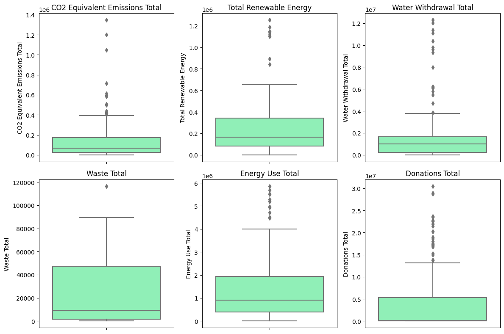
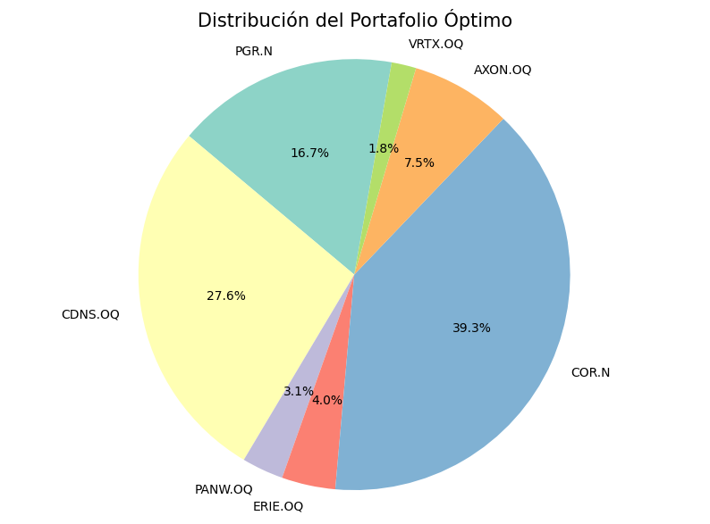

# FINANHACK 2024 | Exploración ESG y construcción de un portafolio de inversiones

Trabajo de equipo presentado por **Full Storm** en FINANHACK 2024. Exploramos indicadores ambientales, sociales y de gobernanza (ESG) de empresas incluidas en tres índices bursátiles, agrupamos empresas con características similares y usamos la selección resultante para construir una cartera de práctica. Dentro del equipo, investigué la extracción de datos con la API de Refinitiv, limpié, diseñé y ejecuté el flujo de análisis en Python y presenté los resultados.

## Problema

¿Cómo comparar empresas mediante variables ESG concretas, sin depender solo de una puntuación agregada, y usar esa exploración para seleccionar activos? El equipo planteó esta pregunta a partir de las diferencias entre empresas en indicadores ambientales, sociales y de gobernanza. El objetivo fue pasar de una lista amplia a una lista manejable y estudiar después una cartera; la agrupación estadística por sí sola no demuestra sostenibilidad ni rentabilidad futura.

## Datos

El notebook consulta Refinitiv/Eikon para obtener variables ESG del ejercicio fiscal **2022** de integrantes de los universos identificados como **S&P 500 (`0#.SPX`), NASDAQ (`0#.NDX`) y Dow Jones (`0#.DJI`)**. En vez de utilizar un único score ESG, trabaja con estas variables individuales:

| Dimensión | Variables consultadas |
| --- | --- |
| Ambiental | Emisiones totales equivalentes de CO₂, energía renovable total, extracción de agua, residuos generados y uso total de energía |
| Social | Total de donaciones |
| Gobernanza | Política de diversidad y oportunidades; política de diversidad en la junta directiva |

También se consultó el sector GICS de cada empresa. Para la cartera se pidieron **precios de cierre mensuales** de acciones con fechas configuradas del **1 de enero de 2020 al 1 de enero de 2024**; la comparación adicional con índices utiliza consultas del **1 de enero de 2023 al 1 de enero de 2024**. La respuesta ESG guardada registra **634 filas y 10 columnas**; después de quitar instrumentos duplicados quedaron **519 empresas**.

Los archivos originales de datos no están disponibles en este repositorio. El [notebook del análisis](notebooks/analisis_esg_y_cartera.ipynb) conserva las salidas obtenidas durante el evento, de las que proceden las figuras y cifras aquí mostradas. Las bibliotecas importadas figuran en [requirements.txt](requirements.txt). Para repetir las consultas se requiere acceso autorizado a las API de Refinitiv/Eikon; los resultados pueden variar con cambios posteriores en la cobertura o en los datos del proveedor.

## Método y herramientas

1. Quitamos instrumentos duplicados y tratamos valores faltantes. Para las variables ambientales se usó la **mediana del sector**; los faltantes de donaciones se reemplazaron por cero y los de las políticas vacías por `False`, supuestos que deben tenerse en cuenta al interpretar los grupos.
2. Aplicamos un filtro secuencial por **rango intercuartílico** a seis variables numéricas. Quedaron **238 empresas**. Se estandarizaron las variables y se aplicó **K-Means con dos grupos**; la elección de dos grupos se apoyó en una lectura exploratoria del gráfico del codo.
3. Se identificaron **25 empresas cercanas a cada centroide** como candidatas, 50 en total. Tres no tenían la serie requerida para el periodo; se solicitaron precios de 47 tickers/activos y se retiraron otros dos por datos faltantes en la primera optimización. Con las series restantes se calcularon retornos logarítmicos mensuales, retornos y covarianzas anualizados, y pesos mediante **SLSQP**. Las restricciones fueron: pesos que suman 1 para cada ticker/activo, sin posiciones short y con un máximo de **50 % por ticker/activo**.

**Habilidades técnicas aplicadas:** consultas de datos financieros con Python, limpieza e imputación con pandas, visualización con Matplotlib/Seaborn, estandarización y agrupación con scikit-learn, y optimización restringida con SciPy.

## Resultados observados

- La preparación redujo las **519 empresas únicas a 238** después del filtro de valores extremos. Este cambio es importante: los grupos describen el subconjunto retenido, no a todas las empresas consultadas.
- El análisis produjo dos grupos y una lista de **50 candidatas** cercanas a los centroides. El gráfico de distribuciones muestra la variación que todavía existe en las variables ESG después del filtrado.
- En la primera cartera calculada, **siete activos recibieron peso positivo**. Los tres mayores concentraron aproximadamente **83,5 %** del peso. Las salidas del notebook registran un retorno medio anualizado calculado de **25,41 %** y una volatilidad anualizada de **15,88 %**. Son resultados del ajuste histórico, no de una inversión real ni de una prueba prospectiva.

## Alcance y límites

La presentación incluyó esta comparación histórica para enero de 2023 a enero de 2024:

| Serie | Retorno anualizado calculado | Volatilidad anualizada |
| --- | ---: | ---: |
| S&P 500 | 17,23 % | 14,37 % |
| NASDAQ | 35,95 % | 17,54 % |
| Dow Jones | 10,96 % | 14,49 % |
| Cartera reoptimizada | 38,15 % | 9,83 % |

La cartera se **volvió a optimizar con datos del mismo periodo** usado para compararla. Por eso, la diferencia numérica de la tabla no es una prueba fuera de muestra ni demuestra que superaría a los índices en otro momento.

La presentación también informa un ratio de Sharpe y una tasa libre de riesgo de 1,98 %. El notebook calculó esa tasa a partir del cambio logarítmico de la serie `US10YT=RR` perteneciente a los Bonos de Tesoro de Estados Unidos como tasa libre de riesgo para el cálculo, por lo que **no interpreto el ratio de Sharpe como una comparación definitiva**. El filtrado excluyó 281 de 519 empresas únicas y la elección de dos grupos fue exploratoria: ambos pasos limitan el alcance de los resultados.

## Aprendizajes

Este proyecto fue mi introducción a investigar cómo usar una API para extraer datos financieros: en este caso, Refinitiv. Aprendí a integrar indicadores ESG, aplicar técnicas de agrupación para explorar candidatas y comunicar un método cuantitativo en equipo. Si repitiera el ejercicio, documentaría el efecto de cada decisión de limpieza y separaría el periodo de construcción de la cartera del periodo usado para evaluarla.
